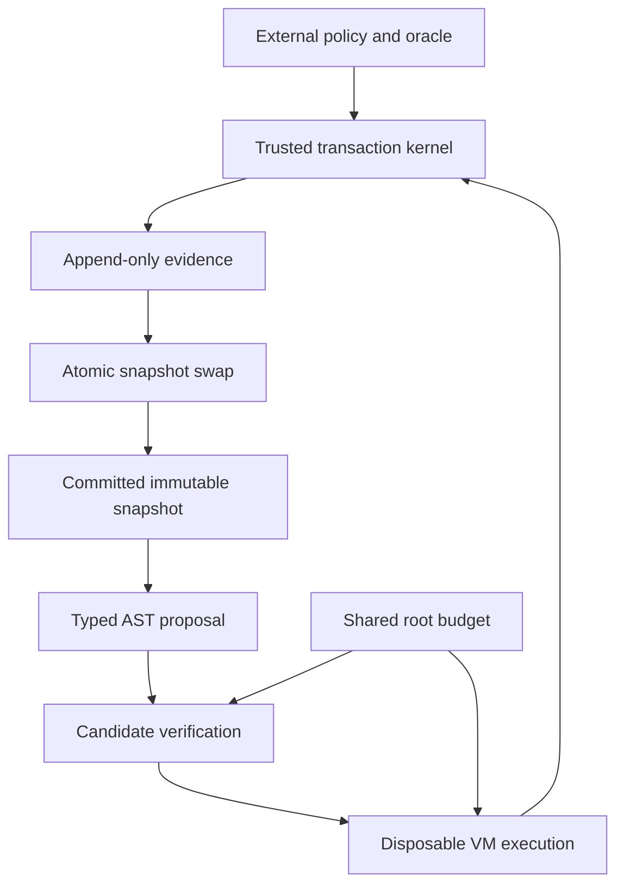

# Architecture and trusted computing base

| Module | Responsibility |
|---|---|
| language | Immutable AST, bounded lexer/parser, canonical representation |
| verifier | Definite assignment, call semantics, shape and capability gates |
| budget | Sticky shared resource account and active-depth scopes |
| runtime | Disposable integer VM with fresh lexical frames |
| snapshots | Content hashes and lineage/policy/oracle-bound snapshot IDs |
| mutation | Allowed value substitutions and specified RNG |
| oracle | Frozen case suite, mandatory behavior, squared-error fitness |
| kernel | Admission, isolated evaluation, selection and commit |
| provenance | Exclusive-create JSONL, hash chain, bounded read/write |
| replay | Reexecution and full semantic evidence comparison |
| cli | Bounded host file ingress and command exit behavior |

The trusted computing base includes these modules plus CPython, stdlib, host OS,
trusted configuration and host-side tools. No claim of verified CPython or trusted
hardware is made. Mutable language nodes contain only strings/integers and AST
children, never Python callbacks or references to host objects. The VM receives
a kernel-owned evolution callback; the program cannot access or replace it.

A candidate gets a new VM for each external case. It cannot reuse committed
frames or outputs. Nested previews never commit. Normal runtime evolution pins
its executing snapshot, so accepted changes have a well-defined future-run effect.
The ledger decision is written/flushed/fsynced before reference swap. There is no
mutable state store to update partially. Host crash may leave incomplete evidence;
replay requires an end seal and rejects such files.

The kernel is deliberately single-owner and single-threaded. Adding concurrent
commit paths or user-defined Python plugins would invalidate the trust model.
